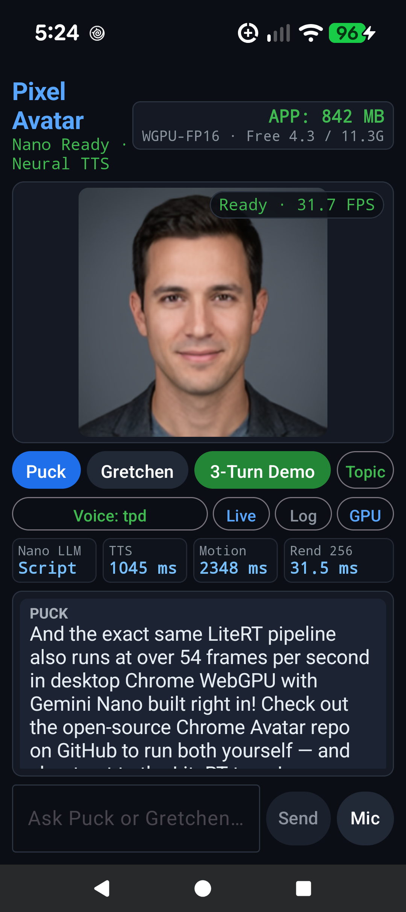
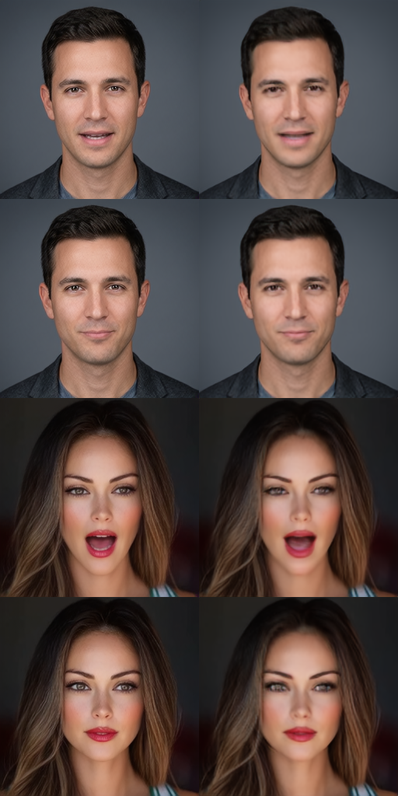

# Chrome Avatar (+ Pixel 10 Native) — 100% Local 512×512 AI Avatar Studio (LiteRT + Gemini Nano)

Real-time **512×512 conversational talking-head avatars** (**Puck** & **Gretchen**) powered by **one single C++ LiteRT Tensor API pipeline** running **100% locally** in two form factors:
1. **Desktop Chrome WebGPU Studio (`web/`):** **Chrome Built-in Gemini Nano** (or in-browser **WebLLM**) + warm Windows SAPI neural voices (`0 GB` VRAM) + **LiteRT.js (`@litertjs/core`) WebGPU** — **`44.5–54.6 FPS`** live with **`0.00 GB` VRAM drift**.
2. **Native Android / Google Pixel 10 Studio (`pixel_avatar/`):** **100% offline** Kotlin + Jetpack Compose app using **LiteRT `2.3.0` (`WGPU-FP16`)** + **Pixel 10 AICore Gemini Nano** (`genai-prompt` with parallel warmup, streaming, and pipelined `0.2 s` turn handoffs) + **offline Android Neural TTS** + our **distilled `6.74 MB` FiLM Mobile U-Net Student (`21×` smaller than teacher!)** — **`33–42 FPS` (`23–30 ms/frame`)** real-time talking heads (`25×–32×` faster than mobile Chrome WebGPU!), **`~850 MB` App RAM**, **`0 s` turn buffering**, hardware-clock audio-locked lip-sync.

No Python inference server. No PyTorch runtime. No cloud LLM APIs. Built natively on Windows (VS 2022 MSVC + CMake, zero WSL).


<p align="center">
  
</p>

---

## Highlights

- **44+ FPS live 512×512 WebGPU avatar rendering** (`22.4 ms/frame` FP32 · `19.6 ms/frame` FP16 on NVIDIA RTX 5090 — **1.8× faster than 25 fps realtime**), **0 unsupported WebGPU ops** across all 3 models.
- **Zero-leak, rock-solid flat VRAM (`0.00 GB` drift across turns):** All 3 FP16-weight `.tflite` models (`397.7 MB` total) compile **once at boot** and stay permanently resident on WebGPU — verified **`4.16 GB → 4.16 GB → 4.16 GB`** across consecutive live turns (`923 / 923` frames, `0` drops).
- **4×–5.4× less VRAM than desktop PyTorch + LM Studio:** **`3.00–4.00 GB` net VRAM** with in-browser WebLLM (`Llama 3.2 1B`), or **`~7.90 GB` net VRAM** with real **Google Chrome Built-in Gemini Nano v3** (`OnDeviceModelService`), vs. **`16.28 GB`** for the desktop Python + LM Studio stack.
- **Direct C++ LiteRT Tensor API authoring (zero Python converters):** All 3 `.tflite` graphs (`wav2vec2_2s`, `fm_step`, `renderer_decode`) are authored directly in C++ from `.safetensors` checkpoints via `litert::tensor::ModelFactory::Save` with `--fp16-weights` (`Type::kFP16` + `Dequantize`) and bit-exact parity verification against PyTorch.
- **Multi-avatar conversational studio:**
  - Instant **Puck ↔ Gretchen** switching (click buttons or say `"Hey Puck..."` / `"Hey Gretchen..."`) with per-avatar portraits, GPU face caches (`9.17 MB` each), SAPI voices (`Andrew (Natural HD)` / `Jenny(Natural)`), and persona prompts sharing one room conversation history.
  - **🎭 3-Turn Demo Chat:** One-click live 3-turn back-and-forth conversation between Puck and Gretchen on preset or custom topics (default: *"What you did last weekend"*).
  - **Live Top-Right Memory HUD:** Real-time GPU VRAM (`Nano`, `WebGPU`, `JS`, and session `Peak`) polled in `~25 ms` via a warm Windows GPU performance counter worker (`GET /api/vram`).
  - **Text + Voice Q&A:** Type or click **🎤 Ask** (`Web SpeechRecognition`) to converse hands-free.

---

## Architecture

```mermaid
flowchart LR
    U["User (Text / Voice / 3-Turn Demo)"] --> LLM["In-Browser LLM<br/>Chrome Gemini Nano v3 (Default)<br/>or WebLLM (Llama 3.2 1B / Gemma 2 2B / Qwen 2.5 1.5B)"]
    LLM -->|"Streaming reply + shared roomHistory"| SAPI["Warm Windows SAPI 5 Worker<br/>Andrew HD (Puck) / Jenny (Gretchen)<br/>0 GB VRAM · ~250 ms"]
    SAPI -->|"16 kHz PCM WAV"| W2V["1. wav2vec2_2s_fp16w.tflite<br/>180.4 MB · WebGPU (~13 ms / 2s)"]
    W2V -->|"a_now + pose_emb"| FM["2. fm_step_fp16w.tflite<br/>74.3 MB · 6-step ODE WebGPU (~19 ms / 2s)"]
    FM -->|"32-D motion tokens + blinks"| REND["3. renderer_decode_fp16w.tflite<br/>143.1 MB · 512×512 WebGPU (22.5 ms / 44.5 FPS)"]
    REND --> CANVAS["HTML5 512×512 Canvas<br/>Synced with Web Audio"]
```



---

## Live Benchmarks & GPU VRAM Comparison (RTX 5090)

Measured live via Windows GPU Process Memory (`Win32_PerfFormattedData_GPUPerformanceCounters_GPUProcessMemory`) + `nvidia-smi`:

| Full Conversational Avatar Stack | LLM Engine | TTS Engine | 512×512 Avatar Engine | **Net AI VRAM** | vs. Desktop |
| --- | --- | --- | --- | --- | --- |
| **Desktop Python PyTorch + LM Studio** *(baseline)* | `llama-server` (`5.71 GB`) | Edge / SAPI (`0 GB`) | Python IMTalker + Whisper (`10.57 GB`) | **`16.28 GB`** | `1.0×` |
| **Chrome 157 Gemini Nano v3 (Default) + IMTalker** | Chrome `OnDeviceModelService` (`3.10 GB`) | Warm SAPI (`0 GB`) | LiteRT.js WebGPU (`chrome gpu-process`) | **`~7.90 GB`** *(~6.9 GB FP16)* | **`2.1×` less** |
| **Browser-Local WebLLM + IMTalker (FP32)** | WebLLM `Llama-3.2-1B-q4f16_1` (`~0.88 GB`, `480 ms` warm) | Warm SAPI (`0 GB`) | LiteRT.js WebGPU FP32 (`44.5 FPS`, `63.6 dB`) | **`4.05 GB`** (`4.16 GB` flat) | **`4.0×` less** |
| **Browser-Local WebLLM + IMTalker (FP16)** | WebLLM `Llama-3.2-1B-q4f16_1` (`~0.88 GB`, `276–412 ms` warm) | Warm SAPI (`0 GB`) | LiteRT.js WebGPU FP16 (`54.6 FPS`, `42.7 dB`) | **`3.00 GB`** (`3.11 GB` flat) | **`5.4×` less** |

### Resident FP16-Weight `.tflite` Models (Zero Per-Turn Recompilation)

| Model | FP32 Size | **FP16-Weight Size** | Parity vs. PyTorch FP32 | Steady WebGPU Speed | Unsupported Ops |
| --- | --- | --- | --- | --- | --- |
| `wav2vec2_2s_fp16w.tflite` | `360.20 MB` | **`180.40 MB`** | `cos_sim = 0.99999996` (`MAE = 3e-5`) | **`~13 ms` / 2.0 s** (`~145×` RT) | **0** |
| `fm_step_fp16w.tflite` | `148.20 MB` | **`74.27 MB`** | `cos_sim = 0.99985790` | **`~19 ms` / 2.0 s** (`~103×` RT) | **0** |
| `renderer_decode_fp16w.tflite` | `285.66 MB` | **`143.06 MB`** | **`PSNR = 63.61 dB`** (`MAE = 0.066/255`) | **`22.5 ms/frame` (`44.5 FPS`)** | **0** |
| **Total** | `794.06 MB` | **`397.73 MB`** | **Visually lossless** | **Zero stage swaps** | **0** |

### Verified Flat VRAM Across 3 Consecutive Live Turns (`923 / 923` Frames)

| Turn (Puck ↔ Gretchen Live Dialogue) | Live FPS (`512×512`) | Motion Time | Browser VRAM | Peak VRAM | JS Heap |
| --- | --- | --- | --- | --- | --- |
| **After Turn 1/3** (Puck · `359` frames) | `44.5 FPS` (`22.5 ms`) | `284 ms` | **`4.16 GB`** | `4.18 GB` | `0.07 GB` |
| **After Turn 2/3** (Gretchen · `366` frames) | `44.2 FPS` (`22.6 ms`) | `273 ms` | **`4.16 GB`** | `4.18 GB` | `0.06 GB` |
| **After Turn 3/3** (Puck · `198` frames) | `44.7 FPS` (`22.4 ms`) | `125 ms` | **`4.16 GB`** | `4.18 GB` | `0.08 GB` |

### Native Google Pixel 10 (`Tensor G5`, Android 17) Benchmarks — 100% Offline

| Pixel 10 Build | Model Size | Unseen Quality | Renderer Latency | **Raw GPU FPS** | App RAM (PSS) |
| --- | --- | --- | --- | --- | --- |
| Chrome 149 Mobile WebGPU (`fp16w`) | `143.1 MB` | `63.6 dB` | `752.1 ms` | `1.33 FPS` | Browser |
| Native LiteRT `2.3.0` Teacher (`fp16w`) | `143.1 MB` | `63.6 dB` | `357.0 ms` | `2.80 FPS` | `2,136 MB` |
| Native LiteRT `WGPU-FP16` (`hd_fast`) | `131.6 MB` | `38.2 dB` | `210.6 ms` | `4.75 FPS` | `1,877 MB` |
| **Distilled FiLM Mobile Student (`256×256`)** | **`6.74 MB` (`21×` smaller!)** | **`36.64 dB` (`MouthMAE 2.75/255`)** | **`23–30 ms`** | **`33–42 FPS` (`25×–32×` Chrome!)** | **`~850 MB`** |

- **Cold boot (all 3 models resident + Nano warmed):** **`~2.1–4.4 s`** (student compiles in `61–153 ms` on `WGPU-FP16`)
- **On-device LLM:** **AICore Gemini Nano** (`genai-prompt:1.0.0-beta5`, parallel `warmup()`, `enableThinking=false`, live streaming, pipelined `0.2 s` turn lookahead in 3-Turn Demo) — **`~550–860 ms` / reply**, 100% offline
- **On-device Voice & Sync:** Offline Android Neural `TextToSpeech.synthesizeToFile()` + hardware `MediaPlayer.currentPosition` audio-locked lip-sync (**25 FPS realtime**, `0 s` buffering)



---

## Repository Layout

```text
Chrome_Avatar/
├── README.md                    # This file (Desktop Chrome + Native Pixel 10 guide)
├── build.md                     # Complete engineering build log, milestones & WebGPU/Pixel 10 learnings
├── Start_Studio.bat             # 1-click desktop launcher: starts hidden server.mjs & opens Google Chrome
├── Stop_Studio.bat              # 1-click clean shutdown for the hidden background server
├── CMakeLists.txt               # Portable CMake target definitions for LiteRT Tensor API
├── fm_step_export.cc            # C++ LiteRT exporter: Flow Matching DiT -> fm_step_fp16w.tflite
├── renderer_decode_export.cc    # C++ LiteRT exporter: StyleGAN + Swin + IMT -> fp16w / hd_fast .tflite
├── student_renderer_export.cc   # C++ LiteRT exporter: Distilled 6.74 MB FiLM U-Net -> student_renderer_256_fp16w.tflite
├── distill_mobile_renderer.py   # RTX 5090 PyTorch distillation script (7,240 teacher frames -> 36.64 dB student)
├── wav2vec2_export.cc           # C++ LiteRT exporter: Wav2Vec2 + projections -> wav2vec2_2s_fp16w.tflite
├── docs/
│   ├── studio_screenshot.png        # Live verified Chrome WebGPU Studio screenshot
│   ├── pixel10_screenshot.png       # Live verified Pixel 10 Tensor G5 native app (38.1 FPS, 850 MB RAM)
│   └── val_teacher_vs_student.png   # Unseen-speech quality parity: 143 MB Teacher vs. 6.74 MB Student
├── avatars/
│   ├── blink_delta.bin          # [9, 32] speaking blink delta tokens
│   ├── puck/                    # Precomputed 9.17 MB NHWC face cache + 512x512 portrait
│   └── gretchen/                # Precomputed 9.17 MB NHWC face cache + 512x512 portrait
├── web/
│   ├── demo.html                # 100% browser-local conversational studio UI
│   ├── server.mjs               # Zero-framework Node HTTP server (COOP/COEP + /api/tts + /api/vram)
│   ├── sapi_worker.ps1          # Persistent warm Windows SAPI 5 COM worker (~250 ms, 0 GB VRAM)
│   ├── vram_worker.ps1          # Persistent warm Windows GPU VRAM counter worker (~25 ms poll)
│   ├── package.json             # @litertjs/core + @mlc-ai/web-llm
│   ├── index.html               # Standalone fm_step.tflite WebGPU parity benchmark
│   ├── renderer.html            # Standalone renderer_decode.tflite 512x512 WebGPU benchmark
│   └── samples/                 # Real Windows SAPI demo WAVs for Puck & Gretchen
└── pixel_avatar/                # 100% Offline Native Android Studio Project (Kotlin + Compose)
    ├── build.gradle.kts         # Gradle 8.13 + Kotlin 2.4.0
    └── app/
        ├── build.gradle.kts     # LiteRT 2.3.0 (litert + litert-gpu) + ML Kit GenAI Prompt & TTS (AICore)
        └── src/main/
            ├── java/com/pixelavatar/app/
            │   ├── MainActivity.kt      # Dark Compose Studio (Live/12.5/25FPS, Voice cycle, Topic/X Showcase, Mic, RAM HUD)
            │   ├── AvatarPipeline.kt    # Native LiteRT 2.3.0 WGPU-FP16 3-model engine + auto-download
            │   ├── NanoLlmClient.kt     # Pixel 10 AICore Gemini Nano client (parallel warmup, streaming, disable-thinking)
            │   └── AndroidTtsEngine.kt  # Offline Android SEANet Neural TTS (tpd/iog defaults, 9-voice cycle) + ML Kit GenAI TTS ready
            ├── res/                     # Custom Gretchen adaptive circular launcher icon
            └── assets/avatars/          # Bundled Puck & Gretchen face caches + blink_delta
```

---

## Quickstart

### Prerequisites
- **Windows 10/11** with **Node.js 20+** and a **WebGPU-capable GPU**
- **Google Chrome** (for built-in **Gemini Nano** Prompt API — default) or any WebGPU browser (automatically supports **WebLLM** `Llama 3.2 1B` / `Gemma 2 2B` / `Qwen 2.5 1.5B`)
- **Zero manual model builds required:** All 3 pre-exported FP16-weight `.tflite` models (`397.7 MB` total) are hosted on [**Release `v1.0.0`**](https://github.com/jjmlovesgit/Chrome_Avatar/releases/tag/v1.0.0) and **download automatically on first launch** when you run `Start_Studio.bat`!
  - [`wav2vec2_2s_fp16w.tflite`](https://github.com/jjmlovesgit/Chrome_Avatar/releases/download/v1.0.0/wav2vec2_2s_fp16w.tflite) (`180.4 MB`)
  - [`fm_step_fp16w.tflite`](https://github.com/jjmlovesgit/Chrome_Avatar/releases/download/v1.0.0/fm_step_fp16w.tflite) (`74.3 MB`)
  - [`renderer_decode_fp16w.tflite`](https://github.com/jjmlovesgit/Chrome_Avatar/releases/download/v1.0.0/renderer_decode_fp16w.tflite) (`143.1 MB`)

### 1. Clone & One-Click Launch (Recommended — Turnkey, Zero Terminal Window)

```powershell
git clone https://github.com/jjmlovesgit/Chrome_Avatar.git
```

Then double-click **`Start_Studio.bat`** in the `Chrome_Avatar` folder:
- **First run only:** Automatically downloads the 3 FP16-weight `.tflite` models (`397.7 MB` total) from GitHub Release `v1.0.0` and runs `npm install` inside `web/`.
- **Every launch:** Starts `node server.mjs` **completely hidden in the background** (no terminal window left open), waits for `http://127.0.0.1:8765/`, and opens **Google Chrome** directly to the studio.
- **Clean shutdown:** Double-click **`Stop_Studio.bat`** anytime to stop the hidden background server and its SAPI/VRAM workers.

*(Want to run manually in a terminal instead? Download the 3 `.tflite` files from [Release `v1.0.0`](https://github.com/jjmlovesgit/Chrome_Avatar/releases/tag/v1.0.0) into the repo root, run `cd web && npm install && node server.mjs`, and open http://127.0.0.1:8765/ in Google Chrome.)*

### 2. Why Is `node server.mjs` Needed If All AI Runs in Chrome?

**Zero AI inference runs in `server.mjs` (`0 GB` VRAM).** Every neural model (Chrome Gemini Nano / WebLLM + `wav2vec2_2s`, `fm_step`, and `renderer_decode`) executes **100% inside Chrome on WebGPU**. `server.mjs` is only a lightweight local bridge for 3 things Chrome's security sandbox forbids from a bare `file://` HTML file:

1. **Local HTTP + `COOP` / `COEP` headers:** Chrome blocks ES modules, local `.tflite` fetches, `window.LanguageModel` (Gemini Nano), and `SharedArrayBuffer` (required by LiteRT.js WASM) over `file://`.
2. **Raw 16 kHz PCM audio from Windows SAPI voices (`POST /api/tts`):** Browsers can *play* OS voices via `speechSynthesis`, but intentionally block capturing raw PCM audio bytes from it — and `wav2vec2_2s.tflite` needs the raw waveform to drive exact lip-sync (`0 GB` VRAM).
3. **Live GPU VRAM HUD (`GET /api/vram`):** Browsers hide exact GPU VRAM usage from JavaScript for privacy/fingerprinting reasons, so `vram_worker.ps1` polls Windows' GPU performance counter (~25 ms) for the top-right HUD.

### 3. Open in Google Chrome & Precision Modes

Open a **normal (non-Incognito) Google Chrome** window *(use Google Chrome rather than Edge/Firefox for built-in Gemini Nano)*:

- **FP32 (`63.6 dB` renderer · `~44.5 FPS`):** http://127.0.0.1:8765/
- **FP16 (`-1.0 GB` VRAM · `~54.5 FPS` · `42.7 dB` visually lossless):** http://127.0.0.1:8765/web/demo.html?precision=fp16

> **Enabling Chrome Built-in Gemini Nano (Default):**
> 1. Make sure you are in **Google Chrome** on `http://127.0.0.1:8765/` (or `http://localhost:8765/`), not Incognito.
> 2. If Chrome reports `LanguageModel` unavailable, open `chrome://flags/#prompt-api-for-gemini-nano`, set it to **Enabled**, and relaunch Chrome.
> 3. If Gemini Nano is already downloaded (`OptGuideOnDeviceModel`), it pre-warms automatically on boot (`Gemini Nano Ready`). Otherwise click **⬇ Download Nano** or send your first message to trigger Chrome's one-time on-device download.
> 4. **No Chrome / want minimum VRAM?** Select **WebLLM: Llama 3.2 1B (0.88 GB VRAM)** from the **In-Browser LLM** dropdown — it auto-downloads once into browser cache and runs 100% on WebGPU in any browser (**`3.11 GB` total VRAM** in FP16).

### 4. Using the Studio

- **Text or Voice Q&A:** Type in the chat box (press **Enter**) or click **🎤 Ask** to speak into your mic.
- **Swap Avatars with Shared Memory:** Click **Puck** / **Gretchen** (or address them by name, e.g. *"Hey Gretchen, do you agree with Puck?"*) to swap the 512×512 avatar, Windows SAPI voice (`Andrew HD` ↔ `Jenny`), and personality prompt while sharing the same room conversation history.
- **🎭 3-Turn Demo Chat:** Pick a topic from **Demo Topic** (default: *"What you did last weekend"*, or type a custom topic first) and click **🎭 3-Turn Demo Chat** to watch Puck and Gretchen have a live 3-turn back-and-forth conversation — then jump right in afterward. Click the red **■** button anytime to stop.
- **Live Precision & Memory HUD:** Switch **Precision (`FP32` / `FP16`)** or **In-Browser LLM** directly in the UI — old WebGPU devices/engines are explicitly torn down and the top-right **Memory HUD** (`VRAM`, `Peak`, `Nano`, `WebGPU`, `JS`) recalculates automatically. Click the HUD anytime to force-refresh and reset `Peak` *(keep only one studio tab open for single-tab VRAM readings)*.

---

## Running the Native Android / Pixel 10 App (`pixel_avatar/`)

1. Open **`Chrome_Avatar/pixel_avatar`** in **Android Studio** (uses JDK 21 / Android Studio JBR, Gradle 8.13, Kotlin 2.4.0, `compileSdk = 36`, `minSdk = 28`).
2. Connect your **Google Pixel 10** (or any arm64 Android device with USB Debugging enabled) and click **Run ▶**.
3. **First launch:** The app automatically downloads the 3 FP16-weight `.tflite` models (`wav2vec2_2s_fp16w.tflite`, `fm_step_fp16w.tflite`, and our distilled **`student_renderer_256_fp16w.tflite`** `6.74 MB` — `261 MB` total) from [Release `v1.0.0`](https://github.com/jjmlovesgit/Chrome_Avatar/releases/tag/v1.0.0) into app-private storage, compiles them on **LiteRT `2.3.0` (`WGPU-FP16`)**, and warms up **AICore Gemini Nano** in parallel.
4. **After first launch:** Unplug USB and turn on Airplane Mode — **Pixel Avatar** (Gretchen's circular icon in your app drawer) runs **100% offline** at **33–42 FPS**!
   - Tap **Puck** / **Gretchen** or **3-Turn Demo** to watch pipelined `0.2 s`-handoff live banter, or tap **Mic** / type to ask anything.
   - Tap **Topic** to set any custom 3-turn conversation prompt, pick a 1-tap preset (including **`★ X Demo Script (LiteRT Showcase)`**), or tap **Reset Default** to return to *"What you did last weekend"*.
   - Tap **Voice: tpd** / **Voice: iog** to cycle & audition all local offline voices per avatar (defaults: Puck = `tpd`, Gretchen = `iog`; also wired with `com.google.mlkit:genai-text-to-speech:1.0.0-alpha1` to auto-upgrade to 24 kHz `star*` diffusion voices once unlocked by Google).
   - Lip-sync locks directly to the hardware `MediaPlayer` audio clock in **`Live`** mode (full 25 FPS synced with zero buffering; tap **Live** to toggle `12.5FPS` / `25FPS` Smooth).
   - To mirror your Pixel 10 screen on your PC inside Android Studio, open **View → Tool Windows → Running Devices**.

---

## Exporting the 3 `.tflite` Models (Native Windows C++, Zero WSL)

All 3 exporters use Google's **LiteRT Tensor API** directly from `.safetensors` checkpoints (`generator.safetensors`, `renderer.safetensors`, `wav2vec2-base-960h/model.safetensors`):

### 1. Build the 3 C++ Exporters Inside `google-ai-edge/LiteRT`

```powershell
git clone --depth 1 https://github.com/google-ai-edge/LiteRT.git C:\Projects\LiteRT

# Point LiteRT's tensor/CMakeLists.txt to this repo's CMakeLists.txt
# (add_subdirectory(examples/imtalker) with -DIMTALKER_SRC_DIR=C:/Projects/Chrome_Avatar)
cmake -G "Visual Studio 17 2022" -A x64 `
  -S C:\Projects\LiteRT\litert `
  -B C:\Projects\LiteRT\cmake_build_win `
  -DLITERT_ENABLE_NPU=OFF -DLITERT_ENABLE_GPU=OFF `
  -DLITERT_BUILD_TESTS=OFF -DLITERT_DISABLE_KLEIDIAI=ON `
  -DIMTALKER_SRC_DIR=C:/Projects/Chrome_Avatar

cmake --build C:\Projects\LiteRT\cmake_build_win --config Release `
  --target imtalker_wav2vec2_export imtalker_fm_export imtalker_renderer_export -- /m
```

### 2. Export FP16-Weight `.tflite` Files

```powershell
$bin = "C:\Projects\LiteRT\cmake_build_win\tensor\examples\imtalker\Release"

& "$bin\imtalker_wav2vec2_export.exe" `
  checkpoints\wav2vec2-base-960h\model.safetensors `
  checkpoints\generator.safetensors `
  wav2vec2_2s_fp16w.tflite --fp16-weights

& "$bin\imtalker_fm_export.exe" `
  checkpoints\generator.safetensors `
  fm_step_fp16w.tflite --fp16-weights

& "$bin\imtalker_renderer_export.exe" `
  checkpoints\renderer.safetensors `
  renderer_decode_fp16w.tflite --fp16-weights
```

---

## Key Engineering Learnings

See [build.md](build.md) for the complete milestone-by-milestone breakdown, including:
- Stripping `265.14 MB` (49%) of training-only VGG loss + offline-precomputed face encoders out of `renderer.safetensors`
- Pure rank-≤-4 `SwinUnifiedAttention`, algebraic `ModulatedConv2d` demodulation, zero-copy `GuidedResampler` (`ArgMax(kI32) + Gather + ResizeNearestNeighbor`), channel-reordered `DepthToSpace(2)` for `PixelShuffle(2)`, and 16-slice weight-norm `pos_conv_embed` for **0 unsupported WebGPU ops**
- Why per-turn `model.delete()` + `loadAndCompile()` leaked WebGPU buffers in `@litertjs/core`, and how `--fp16-weights` (`397.7 MB` total) let all 3 models stay permanently resident with **`0.00 GB` VRAM drift**

---

## Acknowledgements

- [IMTalker](https://github.com/cbsjtu01/IMTalker) for the talking-head motion & synthesis architecture
- [Google AI Edge LiteRT](https://github.com/google-ai-edge/LiteRT) & [`@litertjs/core`](https://www.npmjs.com/package/@litertjs/core) for the C++ Tensor API and WebGPU runtime
- [MLC WebLLM](https://github.com/mlc-ai/web-llm) & Chrome Built-in AI (`LanguageModel` Prompt API / Gemini Nano)
